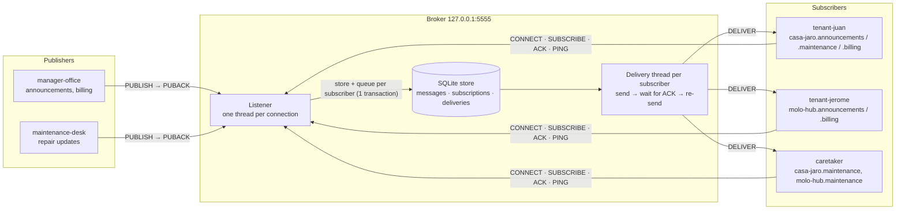

# DormCare Live Alerts: a Publish-Subscribe Messaging System

## Updated UPa interface (November 25, 2026)

The website now uses the approved community-feed layout, purple theme, roommate swipe screen, and UPa branding. The supplied logo's wordmark and app icon are in `assets/brand/`. Its two sign-in roles are **Property owner** and **Tenant**. There are nine [presentation accounts](docs/UPa_Demo_Accounts.md), selectable on the sign-in page: owner `manager`, existing tenants `juan` and `ana`, residents `luis`, `bea`, and `jerome`, and house hunters `miguel`, `sofia`, and `carlo`. Each password is the username followed by `123`. Start it with `scripts\start_website.bat`, then visit `http://127.0.0.1:8000`.

Owners can monitor stored property records, publish advertisements, browse public tenant introductions, configure rental application fields, and approve or decline requests. Tenants can publish a profile and posts, save rental properties, complete application requirements, inquire with owners, and express roommate interest. Roommate conversations require mutual interest.

The UI lives in `marketplace.js`, `marketplace.css`, and `assets/marketplace/`, alongside the original records and broker integration in `app.js`. Existing browser data is preserved. Public profiles, posts, advertisements, and roommate preferences currently persist in the same browser; they are not a deployed public network. The optional broker transports supported messages and application records between the known demo accounts. Stock photographs illustrate demo listings/profiles. Profile and cover photo uploads are resized and saved in browser storage; rental-application file fields retain filenames only. Use sample details.

Open the avatar menu and choose **My profile** to edit your bio, education, location, interests, or custom details, upload a profile/cover photo, and see your previous posts. Property owners also see their public advertisements. The Posts/About tabs and public/private profile controls work for both roles.

Run the current UI checks with `node tests/browser/marketplace_check.mjs [python-executable]` and the presentation-account checks with `node tests/browser/demo_accounts_check.mjs [python-executable]`. The older `browser_check.mjs` covers the previous three-role screens and is retained as historical regression material. The course-project documentation below describes the original broker scenario; its publisher names and protocol roles remain stable for compatibility.

Distributed Systems course project, **Option 2: Build a Publish-Subscribe Messaging System**
(Coulouris, Dollimore, Kindberg & Blair, *Distributed Systems: Concepts and Design*, 5th ed.).

A broker-based publish-subscribe middleware written in Python (standard library only), with:

- **Topic-based filtering**: subscribers register interest in topics and receive only matching messages (§6.3).
- **Durable (persistent) queues**: messages for an offline subscriber are kept in SQLite until it comes back (§6.4).
- **At-least-once delivery**: every message is ACKed. Unacknowledged messages are re-sent after a timeout or on reconnect. Publishers re-send until the broker confirms storage (up to 5 retries, then they report failure), and duplicates are detected on both sides.
- **Confirmed means deliverable**: a message too large or too deeply nested to deliver is refused before it is confirmed.
- **Failure detection and recovery**: crashed clients are detected immediately (socket reset) or by heartbeat timeout. The broker itself can be killed and restarted without losing subscriptions or queued messages.

The demo scenario reuses the **DormCare** rental-management prototype in this folder (`index.html`, `app.js`). The manager's office and maintenance desk of two Iloilo City boarding houses publish alerts, and tenants and the caretaker subscribe to the topics that concern them.

> **Graded code is in [`pubsub/`](pubsub/), [`tests/`](tests/) and [`scripts/`](scripts/).**
> `index.html`, `app.js`, `styles.css` and `DormCare_App_Specification.md` are the DormCare web app. It was
> built earlier as a browser-only prototype and provides the scenario (its broker integration was added for this project). When it is served by
> `python -m pubsub.webapp`, its notifications travel through the broker (section 4, "DormCare website").
> Opened directly as a file, it still works on its own, exactly as before.

---

## 1. Architecture



| Component | File | Responsibility |
|---|---|---|
| Wire protocol | [`pubsub/common/protocol.py`](pubsub/common/protocol.py) | Newline-delimited JSON frames over TCP, message types, validation |
| Broker | [`pubsub/broker/broker.py`](pubsub/broker/broker.py) | Connections, routing, delivery, ACK/re-send, heartbeats, `STATUS` |
| Durable store | [`pubsub/broker/store.py`](pubsub/broker/store.py) | SQLite tables for messages, durable subscriptions and per-subscriber queues |
| Session registry | [`pubsub/broker/registry.py`](pubsub/broker/registry.py) | Which clients are online right now; "newest connection wins" policy |
| Publisher | [`pubsub/publisher/publisher.py`](pubsub/publisher/publisher.py) | Interactive, one-shot and scripted publishing; waits for PUBACK; retries |
| Subscriber | [`pubsub/subscriber/subscriber.py`](pubsub/subscriber/subscriber.py) | Durable sessions, ACKs, duplicate suppression, heartbeats, auto-reconnect |
| Scenario | [`pubsub/scenario/dormcare_scenario.json`](pubsub/scenario/dormcare_scenario.json) | DormCare topics, publishers, subscribers and 13 scripted events |
| Web dashboard (optional) | [`pubsub/dashboard/`](pubsub/dashboard/) | Browser control room for the live demo. It starts the real broker and subscriber processes and shows their output; it is a client of the system, not part of the middleware |
| DormCare website gateway | [`pubsub/webapp/`](pubsub/webapp/) | Serves the DormCare web app and connects it to the broker, so the app's notifications travel through the publish-subscribe system |

## 2. Requirements

- **Python 3.10 or newer**. Tested with 3.11, 3.13 and 3.14 on Windows and 3.12 on Linux; 3.10 is the minimum the code needs but was not tested. Only the standard library is used: `socket`, `threading`, `sqlite3`, `json`, `argparse`, `unittest`.
- Windows or Linux (macOS should work but was not tested). The helper scripts in `scripts/` are Windows `.bat` files; on other systems run the `python -m ...` commands directly.

There are no third-party packages, so [`requirements.txt`](requirements.txt) lists none.

> **Windows tip:** if typing `python` opens the Microsoft Store or prints "Python was not found", that is the
> Store placeholder, not a real Python. Install Python from <https://www.python.org/downloads/> and tick
> **"Add python.exe to PATH"**, or use an existing Anaconda install. The scripts find
> `%USERPROFILE%\anaconda3\python.exe` automatically, and you can also `set DORMCARE_PYTHON=C:\path\to\python.exe`.

## 3. Setup (step by step)

1. Unzip the submission folder.
2. Open a terminal in the project folder (the one containing `pubsub\` and `README.md`).
3. Check Python works:
   ```
   python --version
   ```
   (or `py -3 --version`, or `%USERPROFILE%\anaconda3\python.exe --version`). If only the last one works, use
   `scripts\pyrun.bat` wherever this file says `python`.
4. Optional but recommended: run the tests (1.5 to 2.5 minutes; on Windows a few minimised windows open briefly):
   ```
   python -m unittest discover -s tests -t . -v
   ```
   Expected result: `Ran 105 tests ... OK` on Windows, `OK (skipped=9)` on Linux (the skipped tests are for Windows
   scripts and processes). On Windows you can run `scripts\run_tests.bat` instead.

Nothing else needs installing or configuring. The broker creates `data\broker.db` on first start.

## 4. Running the system

### Quick start on Windows (6 windows)
```
scripts\reset_data.bat      (optional: start with empty queues)
scripts\start_demo.bat
```
This opens the broker, three subscribers (`tenant-juan`, `tenant-jerome`, `caretaker`) and two interactive publishers (`manager-office`, `maintenance-desk`). In a publisher window type `list`, then `send 1`, `send 2`, and so on.

### Manual start (any OS): one terminal per program
```bash
# 1. Broker
python -m pubsub.broker

# 2. Subscribers (each in its own terminal)
python -m pubsub.subscriber --id tenant-juan   --topics casa-jaro.announcements,casa-jaro.maintenance,casa-jaro.billing
python -m pubsub.subscriber --id tenant-jerome --topics molo-hub.announcements,molo-hub.billing
python -m pubsub.subscriber --id caretaker     --topics casa-jaro.maintenance,molo-hub.maintenance

# 3. Publishers (interactive; type "help")
python -m pubsub.publisher --id manager-office
python -m pubsub.publisher --id maintenance-desk
```

### Publisher commands
| Command | Effect |
|---|---|
| `list` | Show this publisher's scripted DormCare events |
| `send 3` / `send all` | Publish scripted event 3 (or every event) |
| `pub casa-jaro.announcements Water interruption \| No water 8 AM to 2 PM` | Publish your own message (title \| body) |
| `status` | Show every subscriber's queue on the broker (online/offline, messages waiting) |
| `quit` | Disconnect |

Other publisher modes:
```bash
python -m pubsub.publisher --id manager-office --topic casa-jaro.announcements --title "Fire drill" --body "Friday 3 PM"
python -m pubsub.publisher --id maintenance-desk --run-scenario --delay 2
python -m pubsub.publisher --id status-check --status
```

### Web dashboard (optional, for presenting)
```
python -m pubsub.dashboard          (or double-click scripts\start_dashboard.bat)
```
Your browser opens at <http://127.0.0.1:8080>. Press **Start demo**. The page shows:
- **Publishers:** the manager's office and the maintenance desk. Click a notice to publish it, or write your own.
- **Broker:** one pigeonhole per subscriber. Envelopes pile up while a subscriber is offline (this is the broker's real queue length, from `STATUS`), and a broker log shows each routing decision.
- **Subscribers:** one phone per subscriber. **Crash** hard-kills that subscriber's process; **Start** reconnects it with the same id, without `--topics`.
- **Fault tests** menu: a subscriber that crashes before its ACK (duplicate suppression), and a broker that loses a PUBACK (publisher retry plus duplicate detection).

The dashboard does not bypass the middleware. It launches the real `pubsub.broker` and `pubsub.subscriber` programs as separate processes, shows what they print, publishes through the real TCP protocol, and asks the broker for `STATUS` once a second. Close the command-line demo windows first: both use broker port 5555 (or run `python -m pubsub.dashboard --broker-port 5600`). Stop it with Ctrl+C in its terminal; that also stops the broker and subscribers it started.

### DormCare website on the broker
```
python -m pubsub.webapp             (or double-click scripts\start_website.bat)
```
The UPa web app opens at <http://127.0.0.1:8000>. It uses the broker already running on port 5555, or starts one. Notifications arrive through the header bell.

**Sign in** as **Property owner** or **Tenant**, select a demo account, and click **Fill demo credentials**.
See the [nine presentation accounts](docs/UPa_Demo_Accounts.md) for credentials and suggested workflows. To switch
users, use the avatar menu and **Log out**. Use separate browser profiles or devices for cross-user delivery demos.

**Presentation baseline:** Luis and Bea have rooms at Casa Jaro, and Jerome has a bedspace at Molo. The six new
tenant accounts have editable sample public profiles. Bills, payments, tickets, applications, posts and messages
are created live. Juan, Ana, Miguel, Sofia and Carlo can demonstrate rental applications; an owner can approve them
into available rooms. Existing saved records are preserved when adding the accounts. Resetting demo data restores
this baseline, including the three resident tenancies.

- Every `notify()` in the app (the 20 places that create notifications, such as rent reminders, payment decisions, ticket updates and join requests) is **published to the broker**. The **bell** fills from what the broker delivers, and the page ACKs each message after saving it.
- Each DormCare user is a **durable subscriber**: `web-manager-m1` (`manager.m1`), `web-admin` (`dormcare.admin`), and `web-tenant-<user>`. A tenant subscribes to `tenant.<user>` for personal alerts, which keeps them apart (not secure: see section 9), and to `<property>.announcements`, such as `casa-jaro.announcements`, for notices.
- **Messages (chat):** tenants and the manager can chat on the **Messages** page. Each tenant's conversation is its own topic (`chat.u-juan`, `chat.u-ana`); the website subscribes the manager to all of them and each tenant only to their own. Every chat message is a PUBLISH. The sender sees *"sending…"* until the broker routes it back, then *"sent through the broker (#n)"*. The other person sees *"via the broker"*, or *"waited at the broker"* if they weren't online. An unread badge appears on Messages.
- **Try it:** first make Juan a tenant: sign in as `juan`, **Join a Property** with `CJD-7K2Q`, then sign in as `manager` and approve him. Now, as Manager, post an announcement for Casa Jaro. Log out and sign in as Juan: the notice was waiting for him at the broker and arrives as catch-up. Or open two windows, `http://127.0.0.1:8000/?role=manager` and `http://127.0.0.1:8000/?role=tenant`, sign in as `manager` and `juan`; Juan files a repair request and the manager updates it: each side sees the other's change live.
- **Records travel with their alerts.** Each browser keeps its own copy of the demo data, so a repair request filed on
  Juan's phone would otherwise exist only there. Maintenance tickets, payment proofs and join requests, and the
  manager's answers to them (ticket updates, verified or rejected payments, approvals), travel inside the alert that
  goes through the broker. The other user's device stores them, live if it is open, or from its queue when that
  user next signs in. The manager's copy is the official one: the manager's answer replaces the tenant's copy of the
  ticket, bill or request, while a tenant's payment proof is *added* to the manager's copy of the bill (so a cash
  payment the manager recorded is never erased), and an approval also carries the room. The receiving page checks
  every record (known fields only, correct types, references to an existing tenant, property and room) and drops
  anything else. Everything else (new invite codes, generated bills, utility splits, listings) stays in the browser
  where it was made: for a tenant joining from another device, use the demo invite code `CJD-7K2Q`.
- Announcements use the same topics as the scenario, so a command-line subscriber (`python -m pubsub.subscriber --id tenant-juan --topics casa-jaro.announcements`) or the dashboard's phones receive the website's announcements too.

How it works: a browser cannot open raw TCP sockets, so `pubsub/webapp/server.py` speaks the normal protocol on the page's behalf. It publishes with `POST /broker/publish`, delivers each user's messages with server-sent events (`GET /broker/stream`), and forwards the page's `POST /broker/ack`. It serves only `index.html`, `app.js` and `styles.css` from the project folder.

### Share a link to the website (any device, no setup)
```
scripts\start_online.bat            (or: python scripts/start_online.py)
```
This puts the DormCare website on a public ngrok link, such as `https://<your-name>.ngrok-free.app`. Any phone or
laptop can open it, on any network (the same Wi-Fi, campus Wi-Fi or mobile data), with nothing to install. Live
alerts and chat work through it. The script prints the link and copies it to the clipboard. It uses the website
already running on port 8000, or starts it (and the broker).

- **One-time setup on the PC that runs the website:**
  1. Install ngrok from the Microsoft Store: `winget install --id 9MVS1J51GMK6 --source msstore`. (The `Ngrok.Ngrok`
     winget package is an old version that ngrok no longer accepts; if you already have it, run `ngrok update`.)
  2. Create a free account at <https://dashboard.ngrok.com/signup>.
  3. Copy your authtoken from <https://dashboard.ngrok.com/get-started/your-authtoken> and, in a new window, run
     `ngrok config add-authtoken <your authtoken>`.
- **The link is fixed.** A free account has one permanent address, so the link stays the same every time and can go
  on a slide or a QR code. It works only while this PC and the script are running.
- **Visitors see an ngrok notice page once** and tap **Visit**; it then stays away on that device for 7 days.
- **How it works:** ngrok makes an outgoing connection from this PC to the ngrok service, which forwards requests for
  the link to the website. No firewall rule, Wi-Fi setting or IP address is needed.
- **Only the website goes through the link.** Command-line subscribers and publishers on other machines still need the
  broker started with `--host 0.0.0.0` on the same network (see Options below).
- **Free-plan limits:** 1 GB of data and 20,000 requests a month, plenty for demos.
- **Visitors must sign in** with a demo account, but those accounts are written in `app.js`, so the sign-in only keeps
  casual visitors out. Stop the script with Ctrl+C after the demo.
- *Why not Cloudflare's free quick tunnels?* They do not support server-sent events, so live alerts never arrive.

### Helper scripts (Windows)
| Script | Purpose |
|---|---|
| `scripts\start_website.bat` | Open the DormCare web app running on the broker |
| `scripts\start_online.bat` | Share the DormCare website on your public ngrok link (needs ngrok) |
| `scripts\start_dashboard.bat` | Open the web dashboard in your browser |
| `scripts\start_demo.bat` | Open all 6 demo windows |
| `scripts\status.bat` | Print every subscriber's queue |
| `scripts\crash.bat tenant-juan` | Hard-kill a subscriber (simulated crash, no goodbye) |
| `scripts\crash.bat broker` | Hard-kill the broker |
| `scripts\reset_data.bat` | Delete all queues and subscriptions (close the broker and subscribers first) |
| `scripts\run_tests.bat` | Run the test suite |
| `scripts\pyrun.bat <args>` | Run Python when `python` is not on PATH, e.g. `scripts\pyrun.bat -m pubsub.broker --help` |
| `scripts\make_submission.bat` | Build `DormCare_Submission.zip` (named `..._DRAFT.zip` while details are still to be filled in) |
| `python scripts\record_demo.py` | Re-record the demonstration logs in `docs\evidence\` |

The full rehearsed demonstration, step by step, is in [`docs/Demo_Runbook.md`](docs/Demo_Runbook.md).

After a crash, the subscriber and broker windows say *"Press any key to start it again"*. A restarted subscriber reconnects with the same id and catches up. It is restarted **without** `--topics`, which shows that the broker remembered the subscriptions.

### Options
Every program accepts `--help`. Useful ones:

| Program | Option | Default | Meaning |
|---|---|---|---|
| broker | `--host` / `--port` | `127.0.0.1` / `5555` | Listening address (use `--host 0.0.0.0` for other machines) |
| broker | `--db` | `data/broker.db` | SQLite file holding the durable queues |
| broker | `--ack-timeout` | `5` s | Re-send an un-ACKed message after this long |
| broker | `--heartbeat-timeout` | `15` s | Drop a client that has been silent this long |
| broker | `--quiet` | off | Hide per-message DELIVER/ACK lines |
| broker | `--fault-skip-puback N` | `0` | **Fault injection:** store the first N messages but drop their PUBACK |
| subscriber | `--crash-after N` | off | **Fault injection:** exit abruptly after processing N messages, before ACKing |
| subscriber | `--no-ack` | off | **Fault injection:** never ACK (shows broker re-sending) |
| publisher | `--puback-timeout` | `5` s | Retry a PUBLISH that is not confirmed in time |
| publisher | `--retries` | `5` | Retries before reporting that the publish failed |

## 5. Protocol summary

TCP is a byte stream (§4.2.4), so each message is framed as **one JSON object per line** (UTF-8, newline-terminated). This is plain text, easy to read in logs and to type by hand.

| Client → broker | Broker → client | Purpose |
|---|---|---|
| `CONNECT {client_id, role}` | `CONNACK {resumed, queued, subscriptions}` | Identify; resume a durable session |
| `SUBSCRIBE {topic}` / `UNSUBSCRIBE {topic}` | `SUBACK` / `UNSUBACK` | Register or remove interest |
| `PUBLISH {msg_id, topic, payload}` | `PUBACK {msg_id, seq, routed_to, duplicate}` | PUBACK is sent only after the message is stored |
| `ACK {seq}` | `DELIVER {seq, topic, publisher, payload, published_at, redelivery}` | Delivery and acknowledgement |
| `PING` | `PONG` | Heartbeat |
| `STATUS` | `STATUS_REPLY {clients, publishers_online}` | Queue depth per subscriber |
| `DISCONNECT` | `ERROR {code, reason}` | Graceful close / rejected request |

Example frame:
```json
{"type":"PUBLISH","msg_id":"manager-office-1a2b3c4d5e6f7a8b","topic":"casa-jaro.announcements","payload":{"title":"Fire safety inspection","body":"Oct 16, 9 AM"}}
```

A frame may be at most 64 KiB. `PUBLISH` is refused with `ERROR BAD_REQUEST` if the `DELIVER` frame it would become
could exceed that, or if its payload is nested more than 64 levels. `CONNACK` and `STATUS_REPLY` shorten lists that
would not fit and add `"truncated": true`.

Topic names are lowercase words separated by dots, `<property>.<category>`. For example: `casa-jaro.announcements`, `molo-hub.maintenance`.

## 6. Delivery semantics (what the system guarantees)

| Rule | Behaviour |
|---|---|
| Delivery guarantee | **At-least-once.** A message stays in the subscriber's queue until the subscriber ACKs it. |
| Duplicates | A re-sent message may arrive twice. The subscriber records each processed message's identity `(seq, published_at)` on disk and ignores repeats; `seq` alone would repeat after a database reset. A re-sent PUBLISH (same `msg_id`) is detected by the broker and not routed twice. |
| Ordering | Each subscriber receives messages in the broker's sequence order (FIFO per subscriber). |
| Confirmation | PUBACK means stored **and** deliverable. A publisher gives up, and says so, after 5 retries. |
| Durability | Subscriptions and queued messages survive subscriber restarts **and** broker crashes (SQLite, WAL mode). |
| Subscriptions | Durable and keyed by `client_id`; reconnect with the same id to resume. |
| History | A new subscription receives only messages published after it was made. |
| No subscribers | A message on a topic with no subscribers is logged by the broker but delivered to nobody. |
| Unsubscribe | Messages already queued for that client stay queued; new ones are no longer routed to it. |
| Same id twice | The newest connection wins; the broker closes the older one, and that subscriber program stops instead of reconnecting. |
| Failure detection | A killed client: immediately (connection reset). A frozen client: after `--heartbeat-timeout`. |

## 7. Tests

```
python -m unittest discover -s tests -t . -v
```

| File | What it checks |
|---|---|
| `tests/test_protocol.py` | Framing over a real socket pair: split frames, merged frames, multi-byte UTF-8 split across reads, malformed and oversized frames, validation |
| `tests/test_store.py` | Routing query, duplicate detection, FIFO queues, ACK, durability after reopening the database |
| `tests/test_integration.py` | F2–F8 routing tests, I1 full DormCare scenario (2 publishers, 4 subscribers, 7 topics), I2 500-message burst |
| `tests/test_faults.py` | X1–X11: subscriber crash and catch-up, crash before ACK, broker crash and recovery, lost PUBACK, malformed input, heartbeat timeout, duplicate ids, 1,000 queued messages |
| `tests/test_dashboard.py` | The web dashboard through its HTTP API: filtering, crash and catch-up as reported to the browser, clear error messages |
| `tests/test_regressions.py` | R1–R9: defects found by the pre-submission audit (undeliverable messages, database reset, robustness, validation) |
| `tests/test_scripts.py` | S1–S4: the Windows demo scripts, also in a folder with spaces and brackets |
| `tests/test_packaging.py` | P1–P5: the submission builder |
| `tests/test_webapp.py` | The DormCare website gateway: serves only the site files, website announcements reach web and command-line subscribers, personal alerts and chats stay private, catch-up and live delivery, ACK, error messages |

The fault tests run the real broker and client programs as separate processes and crash them with a hard kill. The results are written up in `docs/Fault_Test_Report.docx`, and the outputs are in `docs/evidence/`.

A randomized crash test (4 publishers, 6 subscribers that keep disconnecting, 5 broker kills per seed) checks that no
acknowledged message is lost, misrouted or reordered:
```
python -m tests.crash_soak
```

An optional browser check (E01–E34) drives the dashboard and the website in headless Microsoft Edge. It needs Node.js 22+
and Edge, and nothing else in the project depends on it:
```
node tests/browser/browser_check.mjs <path to python>
```

## 8. Project layout

```
pubsub/
  common/      protocol.py, config.py, console.py, children.py
  broker/      broker.py, store.py, registry.py
  publisher/   publisher.py
  subscriber/  subscriber.py
  scenario/    dormcare_scenario.json
  dashboard/   server.py, static/ (index.html, dashboard.css, dashboard.js): optional web control room
  webapp/      server.py: serves the DormCare web app and connects it to the broker
index.html, app.js, styles.css   the DormCare web app (live alerts through the broker when served by pubsub.webapp)
tests/         test_protocol.py, test_store.py, test_integration.py, test_faults.py, test_dashboard.py,
               test_webapp.py, test_regressions.py, test_scripts.py, test_packaging.py, helpers.py,
               crash_soak.py, browser/browser_check.mjs (both run separately)
scripts/       start_demo.bat, start_dashboard.bat, start_website.bat, run_*.bat, crash.bat, status.bat,
               reset_data.bat, run_tests.bat, pyrun.bat, make_submission.bat/.py, record_demo.py
docs/          System_Design_Document.docx, Fault_Test_Report.docx, Demo_Runbook.md, Presentation.pptx,
               diagrams/ (figures), evidence/ (test output and demo-run logs)
data/          created at run time: broker.db and subscriber logs (not submitted)
```

### Troubleshooting
| Symptom | Fix |
|---|---|
| The website's top bar says **Broker offline**, or chat says *"not sent yet"* | The broker stopped. Close the website window and start `scripts\start_website.bat` again: it starts a fresh broker, which recovers all queues from `data\broker.db`. The page reconnects and re-sends unsent chat messages by itself. |
| *"Another broker is already running on port 5555"* | A broker from the terminal demo or another window is still running. Close those windows, or run `scripts\crash.bat broker`. |
| The website warns that the port *"does not answer like a healthy broker"* | Something other than a working broker holds port 5555. Run `scripts\crash.bat broker`, then start the website again. |

Brokers and subscribers started by the website or dashboard now stop automatically when that window is closed, so a leftover broker should no longer happen.

## 9. Known limitations

- **One central broker.** It is a single point of failure for availability. Its state survives a crash, but no messages flow while it is down. Replicated or federated brokers (§6.3 implementation issues) are future work.
- **No authentication or encryption.** Any client can claim any id or subscribe to any topic, so the website's per-tenant and chat topics separate messages but do **not** protect them. Real privacy would need broker-side access control; see the design document.
- **The dashboard and website servers are for local use.** They accept requests from any web origin.
- **The website's sign-in is for the demo only.** The accounts and passwords are written in `app.js` and checked in the
  browser, and the gateway's `/broker/...` requests do not check them. Anyone who reads the code, or calls the gateway
  directly, can still read and post as any user. Real sign-in would check a password hash on the server and give the
  broker per-user access rules.
- **The shared link is public.** While `scripts\start_online.bat` runs, anyone who has the link reaches the sign-in page,
  and anyone who also knows the demo accounts can read and post, including announcements and chat.
- **Only some records are shared between devices.** Tickets, payment proofs and join requests travel with their alerts;
  everything else stays in one browser (including inquiries and invite-code use counts). A browser that is new,
  cleared or reset starts from the presentation baseline and does not receive earlier records; records it receives later for tenants it does
  not know are dropped. A user's own changes do not reach that user's other devices (the manager's phone does not
  learn that the manager's laptop verified a payment). When one user is open on two devices, a device that was closed
  misses records the other device already received.
- **The broker keeps subscriptions after a reset.** The website never unsubscribes, so a tenant who was once a member
  is still subscribed to that property's announcements; the page ignores announcements for a property the tenant does
  not live in. To start over completely, use **Reset Demo Data** in every browser and run `scripts\reset_data.bat`
  with the website and broker stopped.
- **No publisher outbox.** A publish that fails after its retries must be sent again by the user.
- **The website never unsubscribes.** A tenant who moves keeps receiving the previous property's announcements.
- **Tested on one machine only**, over the loopback interface.
- **Exact-match topics only.** No wildcards or content-based filters (the trade-off is discussed in the design document).
- **Durability against process crashes, not power loss.** SQLite runs with `synchronous=NORMAL` for speed. `synchronous=FULL` would also cover power failure, at the cost of a disk flush per message.
- The broker's message log is never trimmed. A production system would delete fully-delivered messages after a retention period.

## 10. References and citations

**Textbook:** G. Coulouris, J. Dollimore, T. Kindberg, G. Blair, *Distributed Systems: Concepts and Design*, 5th ed., Addison-Wesley, 2012. Chapters 4 (interprocess communication), 5 (remote invocation: call semantics), 6 (indirect communication: publish-subscribe, message queues) and 7 (OS support: threads). Section and page references are in the design document (section 12).

**Documentation consulted** (no code was copied from these sources):
- Python documentation: [`socket`](https://docs.python.org/3/library/socket.html), [`threading`](https://docs.python.org/3/library/threading.html), [`sqlite3`](https://docs.python.org/3/library/sqlite3.html), [`json`](https://docs.python.org/3/library/json.html), [`argparse`](https://docs.python.org/3/library/argparse.html), [`unittest`](https://docs.python.org/3/library/unittest.html), [`subprocess`](https://docs.python.org/3/library/subprocess.html)
- SQLite documentation: [Write-Ahead Logging](https://www.sqlite.org/wal.html) and [`PRAGMA synchronous`](https://www.sqlite.org/pragma.html#pragma_synchronous)
- Microsoft documentation: [Using SO_REUSEADDR and SO_EXCLUSIVEADDRUSE](https://learn.microsoft.com/windows/win32/winsock/using-so-reuseaddr-and-so-exclusiveaddruse)

### Use of AI tools
This project was produced with **extensive use of AI**: Anthropic's Claude, through Claude Code, on 21–24 November 2026.
Most of what is submitted was generated by it, at the group's request.

| Item | Produced by |
|---|---|
| Python broker, publisher, subscriber, dashboard and website gateway (`pubsub/`) | Claude |
| Broker integration, chat and demo sign-in in the web app (`app.js`) | Claude |
| Automated tests, browser check and helper scripts | Claude |
| System Design Document, Fault Test Report, README, runbook, diagrams, presentation slides | Drafted by Claude |
| Test runs and recorded evidence in `docs/evidence/` | Run by Claude; the saved files are the real outputs |
| Pre-submission audit and the resulting fixes | Claude (not an independent human review) |
| Assignment, decision to proceed, requests for the dashboard, website integration and chat, report of a broker failure found in use | The group |
| Original DormCare web prototype and specification (October 2026, before this project) | [TODO: prototype authorship] |

Instructor's permission for AI use: [TODO: ai permission]

## 11. Team

Each member states what they personally did. Work listed above as produced by Claude is not a member's contribution,
although directing, reviewing, testing, correcting and presenting it can be.

| Member | Actual contribution |
|---|---|
| [TODO: member 1 name] | [TODO: member 1 contribution] |
| [TODO: member 2 name] | [TODO: member 2 contribution] |
| [TODO: member 3 name] | [TODO: member 3 contribution] |
| [TODO: member 4 name] | [TODO: member 4 contribution] |
| [TODO: member 5 name] | [TODO: member 5 contribution] |
